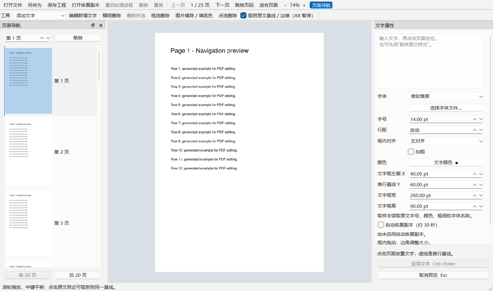
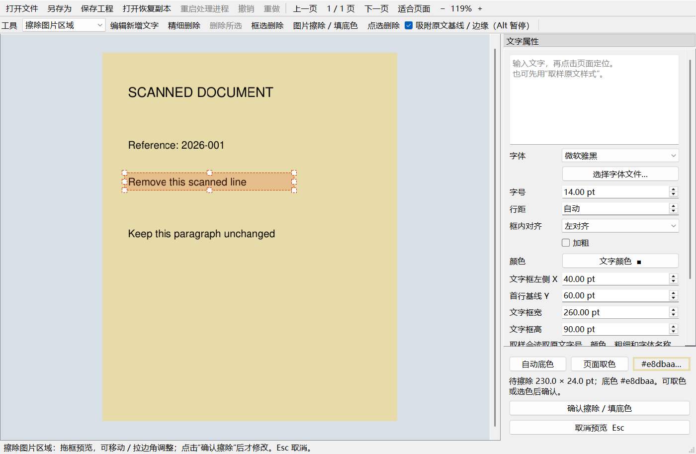

# Light PDF Editor v0.6.0-rc.2 · Qt Edition · Personal Use

English | [简体中文](README.md) | [Roadmap](ROADMAP.md) | [Changelog](CHANGELOG.md)

> **Personal use / 自用**: a small utility for everyday PDF text edits. Commercial support and ongoing maintenance are not promised.


A Windows desktop PDF text editor with a Chinese interface. This version replaces the Tkinter implementation with **PySide6 / Qt and a separate PDF worker process**. Files are processed locally.

Precise deletion now filters candidate glyphs spatially on dense pages; see [benchmark scope and measured results](BENCHMARKS.md).

v0.6.0-rc.2 caches recently visited page content (up to 4 pages and 16 MiB of serialized payload), avoiding repeated extraction and preview generation. Edits invalidate cached content. See [measured scope and results](BENCHMARKS.md).

## v0.6 page navigation

Open “页面导航” in the toolbar and click a thumbnail to change pages. The panel holds up to 20 pages per group, with previous/next group buttons; only visible thumbnails are rendered. Enter a page number and click “跳转”, or use **Ctrl+G**. Apply or cancel pending text/erasure previews before changing pages.



## Portable Windows release candidate

Download the Windows x64 ZIP from [GitHub Releases](https://github.com/BSRain/light-pdf-editor/releases), extract everything and run `LightPDFEditor.exe`. Keep `PdfWorker.exe` and `_internal` beside it. See [build and validation notes](BUILD_WINDOWS.md). Clean Windows without Python and physical multi-monitor validation remain pending.

## Start

1. Install Python 3.10 or newer on Windows with **Add Python to PATH** enabled.
2. Clone or extract this repository and double-click **start.bat**.
3. The launcher creates `.venv` and installs dependencies on first use. Existing installations automatically install Qt if missing.
4. Close the old application before restarting. Drop one PDF into the editing view or choose **打开文件** (Open file).

The initial Qt download is larger than the old version; subsequent use can be offline. Run normally, not as Administrator, to avoid Windows file-drop privilege restrictions. The repository contains no personal PDFs, virtual environments, or font files.

## Align new text with existing text

1. Select **取样原文样式** (Sample original style) and click the reference text.
2. The properties panel shows the detected font, size, color, and weight. If no matching local font is available, the selected fallback is explicitly identified.
3. Enter the new text and click its intended position. The clicked height represents the first text **baseline**, rather than the top of a box.
4. Nearby original baselines and text edges act as snap targets. Blue guides show the alignment. Hold **Alt** while dragging to disable snapping temporarily.
5. Drag inside the box to move it, or drag any of the eight handles to resize it. The side panel provides exact X, first-baseline Y, width, and height values in PDF points.
6. Review the PDF engine's text preview, then click **应用文字** (Apply) or press **Ctrl+Enter**. Press **Esc** to cancel the draft.

Changing font or size preserves the first baseline where page bounds permit. Baseline snapping currently supports extractable text that is horizontal on screen. Scans, outlined glyphs, and vertical text do not provide supported baseline targets.

In small windows, Apply and Cancel remain fixed below the scrollable properties. Font, size and position controls respond to the wheel only after receiving keyboard focus. **内置中文字体** (built-in Chinese font) is always available and becomes the default when no supported Chinese system font is installed.

## Re-edit inserted text

1. After applying text, choose **编辑新增文字** (Edit inserted text) and click its box.
2. Change its text, font, size, color or bold state, drag to move, or resize using the handles.
3. The preview hides the old text while editing. **应用修改** / Ctrl+Enter replaces it; Esc restores the original state.
4. An update is one undoable/redoable operation. Saving does not end the session, so editing can continue after export.

**Scope:** newly inserted and project-restored text boxes are tracked. Reopening a normal PDF starts a new session; .lpdf projects restore tracked boxes. Exported PDF text remains ordinary content. Text deletion keeps independent boxes away from the affected region editable. Intersecting boxes and their overlapping cluster become ordinary PDF text; undo restores editing. Clicking overlapping boxes opens a picker with text excerpts and coordinates; cancellation leaves the document unchanged.


## Editing and saving

- Chinese and English text, multiline layout, font size, color, bold, and local TTF / OTF / TTC fonts.
- Native bold font variants when available, with synthetic stroke bold otherwise. Inserted fonts are embedded in the output.
- **精细删除** (Precise delete, recommended): click one character, double-click a token, or drag a box around character centers. Red highlighting is only a preview. Click **删除所选** or press Delete / Backspace with the page focused to apply; Esc cancels. Unselected character text and geometry are checked after removal, with rollback when separation is unsafe.
- **框选删除** (Box delete): drag a rectangle to remove intersecting characters.
- **点选删除** (Click delete): hover over original text to highlight the PDF text span in red, then click to remove that entire span. Use precise deletion for smaller regions.
- Original-text deletion supports Ctrl+Z undo and preserves images and vector graphics. Use Erase image region for scanned text.
- Click a draft box to focus it, then press **Delete / Backspace** to discard that draft without changing the source document.
- **Redo** uses Ctrl+Y or Ctrl+Shift+Z. A new edit after undo clears the redo branch. Undo and redo share a 20-step / 128 MB snapshot budget, retaining at least one snapshot. Large documents may retain fewer steps. Use Edit inserted text to modify and reposition text created in this session.
- Save as exports a separate file and refuses to overwrite the opened original. Apply or cancel the pending draft first.
- Password-protected PDFs can be opened by entering their password; undo and export preserve encryption.


Precise deletion operates on extractable PDF characters and leaves gaps in place. Fully overlapping characters must be selected together. Double-click selects whitespace/punctuation-delimited tokens, including apostrophes in contractions. Chinese selects contiguous character runs, without semantic segmentation. For scanned images use Erase image region; outlined text is outside precise text deletion.

## After a worker process exits

- Editing stops; text in the side panel remains selectable for copying.
- **重启处理进程** (Restart worker) reopens the latest successful export in this session, or the source if none exists. Open PDF can also select another file.
- **Unsaved edits and session text-box records cannot be recovered**. Restart asks before discarding pending work; encrypted files require the password again.
- Restart does not change the source or successfully saved files. Automatic draft recovery remains planned.

## Controls

| Action | Input |
| --- | --- |
| Open / Save as | Ctrl+O / Ctrl+S |
| Apply / Cancel draft | Ctrl+Enter / Esc |
| Undo / Redo | Ctrl+Z / Ctrl+Y (or Ctrl+Shift+Z) |
| Bold | Ctrl+B |
| Select a token in precise deletion | Double-click text |
| Delete / Cancel precise selection | Delete / Esc with page focused |
| Delete focused draft | Delete / Backspace |
| Zoom around pointer | Mouse wheel |
| Pan | Middle-button drag, or Pan tool |
| Scroll vertically | Shift+Mouse wheel or scrollbar |
| Fit page | Ctrl+0 |
| Nudge focused draft | Arrows: 1 pt; Shift+Arrows: 10 pt |
| Temporarily disable snapping | Alt while dragging |

72 pt equals one inch. Zoom range: 20%–600%.

## Rendering architecture

- Qt transforms existing graphics immediately; wheel handlers do not parse or rasterize the PDF.
- Opening, text extraction, editing, previews, saving, and rasterization run in a separate process.
- After approximately 80 ms without viewport changes, the UI requests only visible 512-pixel tiles. A low-resolution page thumbnail remains underneath while sharp tiles arrive.
- The tile cache has a 64 MiB budget, in addition to visible graphics, the thumbnail, and the PDF engine's own memory. Pending viewport requests are replaced by the latest batch, and stale document results are ignored.
- Re-editing temporarily holds a document copy for the background preview without the old text. Apply/cancel releases it. Export also uses a copy so compaction cannot invalidate the current session’s content references.
- Draft text is a separate transparent layer. Moving it does not clone or render the underlying page. Text, style, or box-size changes request a new text layout.

On this machine, generated text, 1,600-line vector, and large-image fixtures produced median wheel-dispatch-plus-GUI-processing times of about 3.2–3.5 ms (measured locally during v0.3.0 development). **This is not complete PDF render latency or a frame-rate guarantee**, and it is not directly comparable with older benchmarks that measured different operations. The benchmark is included for reproduction.

A new workflow benchmark measures opening, tiles, edits, saves, undo/redo and worker peak working set. See [results and measurement limits](BENCHMARKS.md).

## Development and verification

```powershell
python -m venv .venv
.\.venv\Scripts\python.exe -m pip install -r requirements.txt
.\.venv\Scripts\python.exe pdf_editor.py
.\.venv\Scripts\python.exe -m unittest -v
.\.venv\Scripts\python.exe benchmark_editor.py
.\.venv\Scripts\python.exe benchmark_workflows.py --runs 5
```

69 tests cover worker exit, interrupted edits, restart confirmation/cancellation, reopening the last export, independent boxes surviving redaction, Chinese font/pixel preservation, overlapping-box selection/cancel, reselect/move/update/cancel, preservation of overlapping original text, continued editing after export, encrypted object replacement, double-click token selection, precise selection preview/cancel/commit, neighboring-character protection, cropped and rotated pages, multi-page undo/redo, retained redo after failed edits, actual text removal, graphic preservation, Chinese bold embedding, baseline/export agreement for four page rotations, encrypted undo/export, overflow rollback, tile bounds, Qt file-drop events, Qt mouse dragging/resizing, pointer-centered zoom, style sampling, stale responses, and process isolation. Qt tests require an available desktop session. The physical File Explorer drag gesture is not automatically tested.

| File | Purpose |
| --- | --- |
| `pdf_editor.py` | Qt interface, interaction, scheduling, tile cache |
| `pdf_worker.py` | Isolated PDF owner and JSON pipe protocol |
| `pdf_core.py` | Fonts, insertion/deletion, text geometry extraction |
| `alignment.py` | Baseline/edge snapping and local font matching |
| `test_editor.py` / `test_sessions.py` | Core, Qt and session text editing tests |
| `benchmark_editor.py` | Generated-page interaction benchmark |
| `start.bat` | Windows launcher |
| `version.py` / `CHANGELOG.md` | Version metadata and release history |
| `ROADMAP.md` | Bilingual future-version plan |

## Limitations and personal-use notice

No OCR, direct rewriting of existing text, or document-wide reflow. Exact glyph matching is not guaranteed when the original font is unavailable. Editing signed PDFs can invalidate their signatures. Metadata and attachments are not sanitized.

This project is for personal learning and everyday use. No separate open-source license is included. This notice does not replace the licenses of Qt, PyMuPDF, other dependencies, or installed fonts.

References: [Qt Graphics View](https://doc.qt.io/qtforpython-6.8/overviews/qtwidgets-graphicsview.html), [PyMuPDF](https://pymupdf.readthedocs.io/en/latest/page.html), [PyMuPDF multiprocessing](https://pymupdf.readthedocs.io/en/latest/recipes-multiprocessing.html).

## v0.4.0 layout controls

- Baseline snapping favors text near the box's left anchor, reducing interference from distant columns.
- **行距** specifies the distance between adjacent baselines in PDF points; 0 selects automatic spacing. Style sampling estimates spacing from nearby same-column lines with similar font sizes; review the estimate in the preview.
- Choose **表格单元格填字** and click inside a fully bordered vector cell to create a box with 4 pt padding. Move, resize and apply as usual. Scans, incomplete borders and slanted borders do not support automatic placement.
- Line spacing survives session re-editing, undo and export. Imported font family names are matched; unavailable families such as narrow variants use an explicit fallback.
- Textbox fitting uses actual line count, baseline pitch and font height; a large line pitch no longer falsely rejects a single line. Font size is never reduced automatically. Paragraph reflow and cell merging are outside this release.

## Save an editable project (v0.4.1)

Choose **保存工程** / Ctrl+Shift+S to save a new `.lpdf` file. It contains the current PDF snapshot and applied editable boxes, so moving or deleting the source PDF does not prevent reopening it. Use **打开文件** or drag the project into the view, then choose **编辑新增文字** to continue editing.

Apply or cancel previews before saving. Undo history, unapplied drafts and original font files are not included; another computer may require selecting a local font. Projects from encrypted PDFs retain the original password protection without storing passwords in project metadata. Saving preserves the currently opened original; choose a new filename.

**另存为** / Ctrl+S still exports a regular PDF and removes this application's project editing metadata. Use it for delivery. v0.4.2 offers optional recovery snapshots as described below.

## Automatic recovery snapshots (v0.4.2)

1. After opening a document, enable **自动恢复副本** in the properties panel and choose a local directory. An initial save is attempted immediately, then checked about every 30 seconds; busy document operations defer saves and unchanged content is skipped.
2. Each activation creates a unique `_恢复_date_time_id.lpdf` file and atomically updates it. The panel shows its path and successful-save time. Enable it again after opening another file.
3. Snapshots include committed document edits and the placed, unapplied draft, including a draft re-editing an existing box. They do not apply drafts, clear unsaved state or alter undo history.
4. After a crash, choose **打开恢复副本**, open the saved file, review it, apply/cancel its draft and export a PDF or project. Encrypted snapshots require the original password; passwords are not stored in snapshot metadata.

Only the last successful snapshot is recoverable; later changes may be lost. Input text not yet placed on the page is omitted. Save failures pause automatic recovery with an explanation in the panel, without blocking editing or manual saves. Disabling recovery or closing the app retains existing snapshots; manage the directory and disk space yourself. Recovery snapshots require v0.4.2 or newer.

## v0.5.0-rc.2 layout fixes

- Large baseline spacing no longer falsely rejects a single line; compact cells use the actual font height.
- Boxes narrower than one character are rejected with an explicit widening hint, preventing horizontal overflow.
- Synthetic bold for fonts without a dedicated bold file, such as SimSun, uses stroke width proportional to font size. The previous extra multiplication by font size is removed.

## v0.5.0-rc.3 box alignment and rotated selection

**框内对齐** supports left, center and right alignment within each text box; centering works directly with table-cell placement. X always denotes the box's left edge, and clicks/drags position the box. Style sampling resets to left alignment instead of guessing the source paragraph's alignment.

Alignment survives preview, re-editing, projects and recovery. Files containing the new alignment setting require v0.5.0-rc.3 or newer; older projects remain readable. Precise font metrics fix selection boxes displaced from SimSun and similar text on 180-degree pages.

## Erase part of a scanned image

Choose **擦除图片区域** (Erase image region) from the tool dropdown, drag over the scan and release to preview a red region without modifying the PDF. Drag inside to move, use the handles to resize, or nudge with arrows (Shift: 10 pt). Click Confirm erasure or press Ctrl+Enter to apply; Esc cancels. On confirmation, overlapping image pixels are removed and filled with the chosen background; OCR/extractable text in the area is removed too. Ctrl+Z undoes, Ctrl+Y redoes; Save As exports the result. OCR is not required.

The image pixels are modified rather than covered with a white rectangle. Only the current page is changed; original images reused on other pages remain. Source files, previous exports/recovery copies and session undo history are not automatically deleted. Automatic fill samples the surrounding dominant color; page picking and manual colors are available, without gradient/texture reconstruction. Vector lines and annotations are outside this tool's scope.

After confirmation, select the next area; each confirmed erasure is separately undoable. Pending regions block saving/page changes until confirmed or cancelled. Ctrl+Z first cancels the current region. Automatic recovery retains committed changes, not pending erasure regions.



## Remove raster text and fill its background

Use **图片擦除 / 填底色** on the toolbar and select raster text. Automatic background sampling uses nearby rendered colors. If needed, choose **页面取色** and click a clean background pixel, or click the color value to choose manually. Confirm erasure/fill, then Save As.

Original pixels and overlapping OCR text are removed before the fill is drawn. Automatic sampling suits flat backgrounds; nearby lines/text/photos may require manual picking. Gradients and textures are not reconstructed. Source files, past exports and original images reused on other pages remain.

## Startup troubleshooting

Extract the complete portable ZIP; keep the main EXE, PdfWorker.exe and _internal together. The launcher diagnoses common missing components and recommends a fresh full extraction. Catchable startup failures produce local logs under `%LOCALAPPDATA%/LightPDFEditor/logs`, with a temporary-directory fallback; nothing is uploaded automatically. Logs may include local paths.

OS/Python DLL failures before the launcher starts may still be reported by Windows or the packager. See [local acceptance scope](STABILITY.md); this candidate is unsigned.
