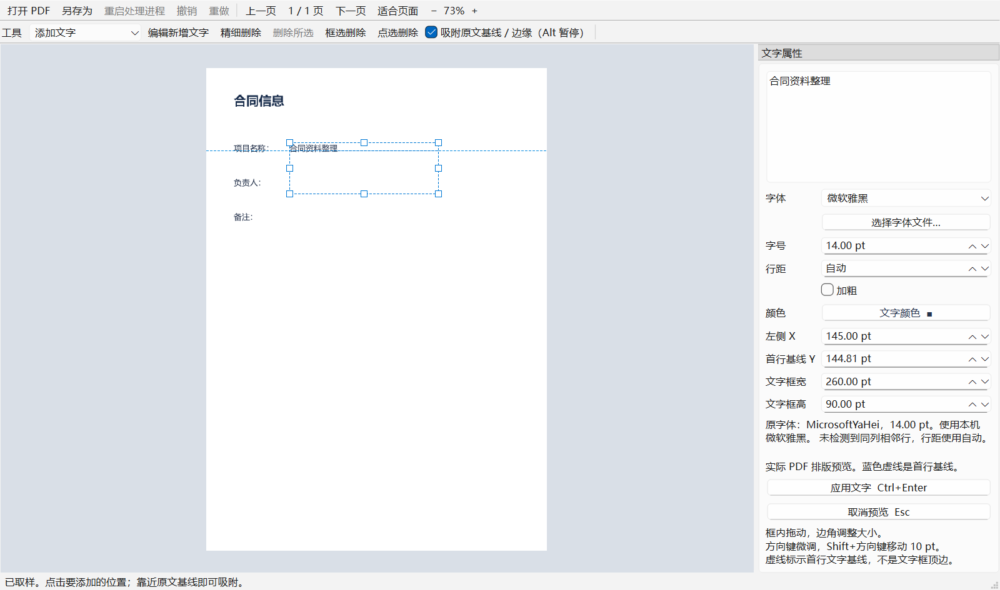
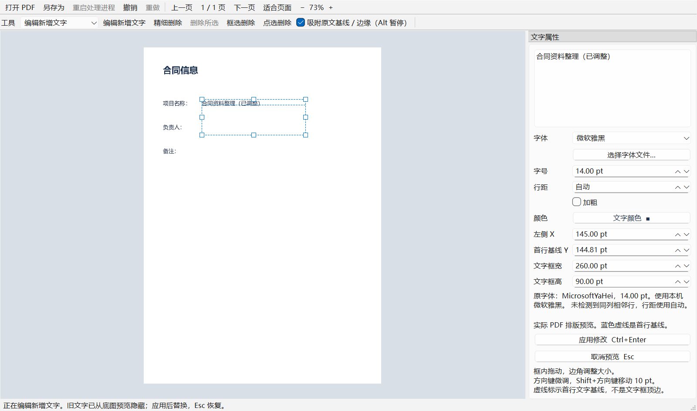
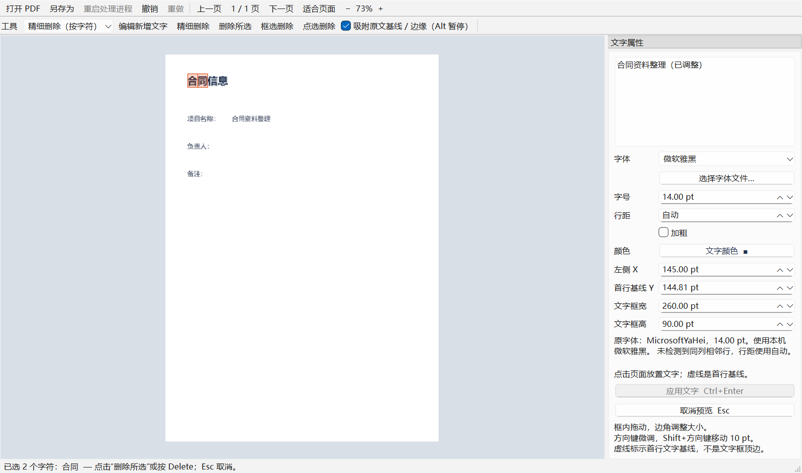

# 轻简 PDF v0.4.0 · Qt 版 · 自用

[English](README.en.md) | 简体中文 | [版本计划](ROADMAP.md) | [更新日志](CHANGELOG.md)

> **自用 / Personal use**：个人日常 PDF 文字修改工具，不承诺商业支持或长期维护。



Windows 中文桌面工具，支持添加和删除 PDF 文字。此版本已从 Tkinter 重构为 **PySide6 / Qt + 独立 PDF 处理进程**。文件在本机处理，不上传服务器。

## 启动

1. 安装 Python 3.10 或以上，勾选 **Add Python to PATH**。
2. 下载或克隆项目，双击 **start.bat**。
3. 首次启动会创建 `.venv` 并安装依赖；旧版用户启动时会自动补装 Qt。
4. 关闭旧窗口后重新启动。把 PDF 拖入编辑区，或点击“打开 PDF”。

Qt 的首次下载体积比旧版大，完成安装后可离线使用。无需管理员权限。仓库不包含个人 PDF、虚拟环境或字体文件。

## 对齐原文：推荐用法

1. 将工具切换为 **取样原文样式**，点击要参考的原文字。
2. 右侧显示检测到的字体名称、字号、颜色与粗细。对应字体在本机不可用时，会明确提示替代字体；不会伪装成完全匹配。
3. 输入要添加的文字，在目标位置点击。点击高度表示首行文字的**基线**，不再要求猜文字框顶边。
4. 靠近原文行时自动吸附到同一基线，并显示蓝色参考线；拖动也会吸附到原文左边缘或右边缘。按住 **Alt** 可临时暂停吸附。
5. 框内拖动移动，四角或四边中点拉伸；也可在右侧精确输入 X、首行基线 Y、宽度和高度。
6. 预览由 PDF 引擎生成。点击“应用文字”（Ctrl+Enter）写入文档，Esc 取消。

修改字体或字号时尽量保持首行基线不动。页面边缘会限制位置。当前只对可提取且在屏幕上水平显示的文字提供基线吸附；扫描件、轮廓文字和竖排文字不支持自动基线对齐。

## 再次编辑已添加文字

1. 应用新增文字后，选择工具栏 **编辑新增文字**，点击该文字框的位置。
2. 修改右侧文字、字体、字号、颜色或加粗；拖动文字框移动，拉动边角调整大小。
3. 预览暂时隐藏旧位置的文字，避免新旧文字叠在一起。点击 **应用修改**（Ctrl+Enter）替换，Esc 恢复原来的文字。
4. 修改作为一个完整操作支持撤销 / 重做；另存为后，不关闭当前文档仍可继续编辑。

**范围限制**：仅跟踪本次打开 PDF 后新增的文字。关闭或重新打开文件后，文字作为普通 PDF 内容保留，不恢复文字框。删除文字后，远离删除范围且不与受影响文字框重叠的新增文字框仍可编辑；相交或相互重叠的一组文字框会转为普通 PDF 文字，撤销这次删除可恢复。点击重叠文字框时，会列出文字摘要与坐标供选择，也可取消。



## 增删与保存

- 支持中英文、多行、字号、颜色、加粗和本机 TTF / OTF / TTC 字体。
- 加粗优先使用本机粗体文件；没有独立粗体时采用描边加粗。新增文字字体嵌入导出 PDF。
- **精细删除（推荐）**：单击一个字符、双击选择词段，或拖动选取中心落在框内的字符；红色高亮仅预览，点击“删除所选”或在页面按 Delete / Backspace 才执行，Esc 取消。删除前后核对未选字符的位置和内容，无法安全分离时回滚。
- **框选删除**：工具栏点击后拖动选区，松开移除相交文字字符。
- **点选删除**：工具栏点击后，将鼠标移到原文，红框预览要删除的文字段；点击删除整个文字段。更精细的局部删除请用“精细删除”。
- 删除原文可 Ctrl+Z 撤销，保留图片和线条；扫描件里的图片文字不能这样删除。
- **删除待添加文字框**：点击框使其获得焦点，再按 Delete / Backspace；只移除草稿，不改变原文。
- **重做**：Ctrl+Y 或 Ctrl+Shift+Z。撤销后执行新的编辑会清空重做分支。撤销与重做共享最多 20 步 / 128 MB 的快照预算（至少保留一个快照），大文件会缩短历史。本次会话新增的文字可用“编辑新增文字”重新修改和定位。
- “另存为”导出新 PDF，不覆盖打开的原稿。保存前需先应用或取消待编辑文字。
- 支持输入密码打开加密 PDF；加密文件撤销、导出时保留加密。



精细删除按 PDF 可提取字符操作，不自动补齐删除后的空隙。完全重叠的字符需一起选择；双击按空白与标点边界选择连续词段，支持英文缩写中的撇号；中文选择连续汉字段，不做语义分词。扫描图片、文字轮廓不支持删除。

## 处理进程异常退出后

- 编辑操作会暂停，右侧输入文字仍可选中复制。
- 点击“重启处理进程”，重新打开本次最近另存的文件；没有另存记录则打开原稿，也可直接“打开 PDF”选择其他文件。
- **未保存修改与文字框记录不能恢复**。重启会询问是否放弃未保存内容，不自动声称已恢复。加密文件重新输入密码。
- 原稿与成功另存的文件不会因重启而改变。自动草稿恢复仍在后续计划中。

## 操作

| 操作 | 鼠标 / 快捷键 |
| --- | --- |
| 打开 / 另存为 | Ctrl+O / Ctrl+S |
| 应用 / 取消预览 | Ctrl+Enter / Esc |
| 撤销 / 重做 | Ctrl+Z / Ctrl+Y（或 Ctrl+Shift+Z） |
| 加粗 | Ctrl+B |
| 精细删除中选择词段 | 双击文字 |
| 删除精细选区 / 取消选区 | 页面获得焦点后 Delete / Esc |
| 删除待添加文字框 | 定位框获得焦点后按 Delete / Backspace |
| 缩放 | 滚轮，鼠标所在位置为中心 |
| 平移 | 中键拖动，或“平移页面”工具 |
| 上下滚动 | Shift+滚轮或滚动条 |
| 适合页面 | Ctrl+0 |
| 微调定位框（框获得焦点后） | 方向键 1 pt；Shift+方向键 10 pt |
| 暂停吸附 | 拖动时按 Alt |

1 pt = 1/72 英寸。缩放范围为 20%–600%。

## 性能设计

- Qt 图形视图直接变换已有图像，滚轮事件不解析或重新渲染 PDF。
- PDF 打开、文字提取、编辑、预览、保存和栅格渲染均在独立进程执行。
- 停止滚动约 80 ms 后，只请求当前视口内的 512 像素图块，逐块补清晰；有低分辨率整页底图。
- 图块缓存预算 64 MiB，另有当前可见图块、整页缩略图和引擎自身内存。后台待处理视口请求只保留最新一批；过期页面结果不会覆盖当前页面。
- 重新编辑新增文字时，后台暂时持有一份文档副本，用于隐藏旧文字的底图预览；应用或取消时释放。另存为也通过副本导出，避免压缩整理影响当前会话的文字定位记录。
- 文字预览和底图分离。仅移动文字框不会重新复制整页或嵌入字体；修改文字或文字框尺寸才重新排版预览。

本机生成测试页的滚轮事件加 GUI 事件处理耗时中位数约 3.2–3.5 ms（v0.3.0 开发期间本机测量），覆盖文字、1600 条矢量线和大图背景三类页面。**这不是完整 PDF 渲染耗时，也不是所有文件的帧率保证**；不能与旧版不同测量方式的数字直接比较。可自行运行基准测试。

新增大文件操作基准，覆盖打开、图块渲染、编辑、保存、撤销 / 重做和后台峰值工作集。结果与测量限制见 [性能报告](BENCHMARKS.md)。

## 开发与验证

```powershell
python -m venv .venv
.\.venv\Scripts\python.exe -m pip install -r requirements.txt
.\.venv\Scripts\python.exe pdf_editor.py
.\.venv\Scripts\python.exe -m unittest -v
.\.venv\Scripts\python.exe benchmark_editor.py
.\.venv\Scripts\python.exe benchmark_workflows.py --runs 5
```

42 项测试覆盖进程退出、编辑中断、重启确认 / 取消、从最近导出恢复工作，以及删除后保留独立文字框、中文字体与像素一致性、重叠框选择与取消，以及新增文字重新选中 / 移动 / 修改 / 取消、重叠原文保留、导出后继续编辑、加密文档对象替换、双击选词段，以及精细删除预览 / 取消 / 提交、紧邻文字保护、裁切与旋转页面、跨页撤销重做、失败编辑保留重做分支，以及真实文字删除与图形保留、中文粗体嵌入、四种页面旋转下的基线一致性、加密文件撤销与保存、溢出事务回滚、分块尺寸、Qt 拖放事件、实际 Qt 鼠标拖动拉伸、指针缩放、样式取样、旧请求丢弃及独立进程。Qt 测试需要可用桌面会话；资源管理器到窗口的真实物理拖动手势尚未自动验证。

| 文件 | 用途 |
| --- | --- |
| `pdf_editor.py` | Qt 界面、图形交互、任务调度及图块缓存 |
| `pdf_worker.py` | 独立 PDF 处理进程与 JSON 管道协议 |
| `pdf_core.py` | 字体、增删文字和原文位置提取 |
| `alignment.py` | 基线 / 边缘吸附及字体匹配 |
| `test_editor.py` / `test_sessions.py` | 核心、Qt 交互与会话文字编辑回归测试 |
| `benchmark_editor.py` | 生成测试页并测量交互响应 |
| `start.bat` | Windows 启动脚本 |
| `version.py` / `CHANGELOG.md` | 当前版本和发布记录 |
| `ROADMAP.md` | 后续版本计划（中英文） |

## 限制与自用说明

没有 OCR、原文字直接改写和全篇重排；没有可用原字体时无法保证字形完全一致。编辑签名 PDF 会影响签名有效性。本工具不清理元数据、附件等，不是敏感资料清理工具。

本项目用于个人学习和日常自用，未附加单独的开源许可证。“自用”标注不改变 Qt、PyMuPDF 等第三方依赖和本机字体的许可条款。

实现参考：[Qt Graphics View](https://doc.qt.io/qtforpython-6.8/overviews/qtwidgets-graphicsview.html)、[PyMuPDF](https://pymupdf.readthedocs.io/en/latest/page.html)、[PyMuPDF 多进程](https://pymupdf.readthedocs.io/en/latest/recipes-multiprocessing.html)。

## v0.4.0 排版设置

- 多栏文档吸附优先选择文字框左侧定位点附近的文字行，减少远处列的干扰。
- 右侧「行距」以相邻基线之间的 PDF 点数计量；0 表示自动。取样会尝试估计同列、近似字号的相邻行，结果仍需在预览中确认。
- 选择「表格单元格填字」，点击有完整矢量边框的单元格，自动放置四周 4 pt 内边距的文字框；之后可拖动、缩放并应用文字。扫描件、缺边表格、斜线边框不支持自动识别。
- 行距随会话内文字框保留，支持重新编辑、撤销和导出。字体匹配支持导入字体的家族名称；无法匹配的窄体等字体明确回退。
- 底层文字框的高度预检偏保守，少数可容纳内容也可能提示增大框；不会为适应框尺寸自动缩小字号。当前不提供段落自动重排或单元格合并操作。
